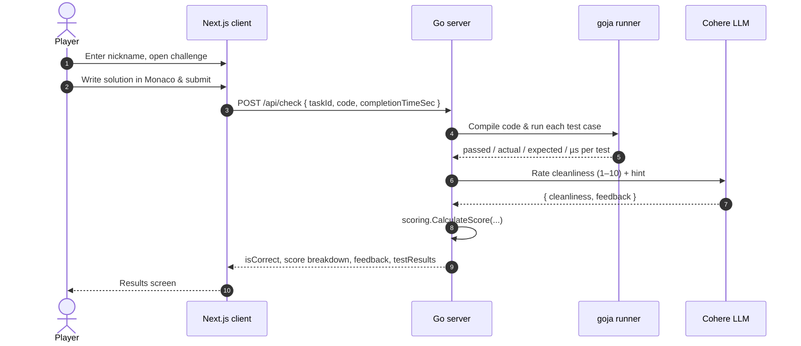

<div align="center">

# ⚡ synqit

### Write code faster. Write it cleaner.

**A competitive coding arena: solve a JavaScript challenge against the clock, run it against hidden tests in a sandboxed engine, and get your code style graded by an AI mentor.**

<br />


[Features](#-features) · [How it works](#-how-it-works) · [Scoring](#-scoring) · [Tech stack](#-tech-stack) · [Getting started](#-getting-started) · [API](#-api) · [Roadmap](#-roadmap)

</div>

<!-- Add a screenshot or GIF of the arena here, e.g.:
<p align="center"></p>
-->

---

## 🎯 What is synqit?

**synqit** turns coding practice into a race. Pick a nickname, take your spot in the arena and solve a task in a full-featured in-browser editor while the timer ticks.

When you submit, your solution isn't just checked for *correctness*. It is:

1. **Executed** against test cases inside an isolated JavaScript engine embedded in the Go backend.
2. **Benchmarked**: each test run is timed in microseconds.
3. **Reviewed** by an LLM that rates readability and cleanliness from 1 to 10 and gives you a *hint*, never a ready-made answer.
4. **Scored** on correctness, speed, style, task difficulty and how long you took.

The winner isn't the one who knows more, it's the one who types more precisely.

## ✨ Features

| | |
|---|---|
| 🧑‍💻 **Monaco editor** | The same editor that powers VS Code, right in the browser. |
| ⏱️ **Live timer** | Every second counts; finishing slowly costs you points. |
| 🧪 **Sandboxed test runner** | User code runs in [goja](https://github.com/dop251/goja), a pure-Go JS engine. No Node process, no `eval` on the host. |
| 🤖 **AI code review** | Cohere (with Gemini as an optional provider) rates code cleanliness and leaves a short guiding tip. |
| 📊 **Score breakdown** | Separate cleanliness, speed and time penalty, plus a total score. |
| 🛡️ **Graceful degradation** | If the AI provider is down, tests still run and you still get a score. |
| 🎨 **Distinctive UI** | Glassmorphism, scramble-text animations, a CRT effect and GSAP motion. |
| 🐳 **One-command setup** | Frontend, backend and Postgres start with `docker compose up`. |

## 🔄 How it works



### Player flow

```
  /            →   /profile      →   /challenge         →   /results
  pick a           your stats        editor + timer         time, cleanliness,
  nickname         & start           + live feedback        speed, total score
```

## 🏆 Scoring

A wrong solution scores **0**. A correct one is scored like this:

```
total = round( (cleanliness + speed) × difficultyBonus ) − timePenalty
```

<table>
<tr>
<td valign="top">

**⚡ Speed** (average run time per test)

| Execution | Points |
|---|:---:|
| ≤ 60 µs | 10 |
| ≤ 150 µs | 7 |
| ≤ 350 µs | 4 |
| ≤ 700 µs | 2 |
| > 700 µs | 1 |

<sub>Medium tasks add +2 and hard tasks add +4 to speed (capped at 10).</sub>

</td>
<td valign="top">

**🎚️ Difficulty bonus**

| Difficulty | Multiplier |
|---|:---:|
| easy | × 1.0 |
| medium | × 1.2 |
| hard | × 1.5 |

**⏳ Time penalty**

The first **2 minutes** are free. After that you lose **−1 point per 30 s**, up to **−5**.

</td>
</tr>
</table>

**🧹 Cleanliness** (1–10) comes from the AI review: naming, no dead or duplicate code, idiomatic JS.

## 🛠 Tech stack

<table>
<tr>
<th>Frontend</th>
<th>Backend</th>
<th>Infrastructure</th>
</tr>
<tr>
<td valign="top">

- **Next.js 16** (App Router)
- **React 19** + **TypeScript**
- **Tailwind CSS 4**
- **Monaco Editor**
- **GSAP** animations
- **lucide-react** icons
- **Geist** font

</td>
<td valign="top">

- **Go 1.27** with standard `net/http` (`ServeMux` method routing)
- **goja** JS runtime
- **GORM** + **pgx**
- **Cohere** `command-a-plus` chat API
- **Gemini** (optional provider)

</td>
<td valign="top">

- **PostgreSQL 16**
- **Docker** multi-stage builds
- **Docker Compose** with healthchecks
- Next.js `standalone` output
- Optional HTTP proxy passthrough

</td>
</tr>
</table>

## 📁 Project structure

```
synqit/
├── client/                    # Next.js frontend
│   └── app/
│       ├── page.tsx           # Landing + nickname "login"
│       ├── profile/           # Player profile
│       ├── challenge/         # Monaco editor, timer, submit
│       ├── results/           # Final time & score breakdown
│       ├── CrtEffect.tsx      # CRT screen effect
│       └── functions/         # Scramble text animation
│
├── server/                    # Go backend
│   ├── main.go                # HTTP server, CORS, .env loader
│   └── internal/
│       ├── ai/                # /api/check handler + LLM providers
│       ├── runner/            # goja sandbox + task definitions
│       ├── scoring/           # Score formula
│       ├── models/            # GORM models: User, Task, TestCase
│       └── db/                # Postgres connection + auto-migrations
│
└── docker-compose.yml         # client + server + postgres
```

## 🚀 Getting started

### Prerequisites

- [Docker](https://www.docker.com/) with Compose, **or** Go 1.27+, Node.js 20+ and PostgreSQL 16
- A [Cohere API key](https://dashboard.cohere.com/api-keys) for AI review (optional: without one, tests still run and cleanliness defaults to 5)

### 1. Configure environment

```bash
cp server/.env.example server/.env
```

```env
CLIENT_URL=http://localhost:5173
SERVER_PORT=3000

AI_API_KEY=your_cohere_api_key
GEMINI_API_KEY=your_gemini_api_key

DB_HOST=localhost
DB_USER=synqit
DB_PASSWORD=supersecret
DB_NAME=synqit_db
DB_PORT=5432

JWT_SECRET=your_jwt_secret_key
```

> The same `server/.env` also configures the Postgres container: `DB_USER`, `DB_PASSWORD` and `DB_NAME` are mapped to `POSTGRES_*` automatically.

### 2a. Run with Docker 🐳 (recommended)

```bash
docker compose up --build
```

| Service | URL |
|---|---|
| 🌐 Frontend | http://localhost:5173 |
| ⚙️ Backend | http://localhost:3000 |
| 🐘 PostgreSQL | `localhost:5433` |

Behind a proxy? Pass it through:

```bash
HTTP_PROXY=http://host.docker.internal:2080 HTTPS_PROXY=http://host.docker.internal:2080 docker compose up
```

### 2b. Run locally

```bash
# database only (exposed on port 5433)
docker compose up -d postgres
# then set DB_PORT=5433 in server/.env

# backend
cd server
go run .

# frontend (in another terminal)
cd client
npm install
npm run dev
```

## 📡 API

### `GET /api/health`

```json
{ "status": "ok", "message": "server is healthy" }
```

### `POST /api/check`

Runs the solution against the task's tests, asks the AI for a review and returns the score.

<details>
<summary><b>Request</b></summary>

```json
{
  "taskId": "reverse-string",
  "code": "function reverseString(str) { return [...str].reverse().join(''); }",
  "completionTimeSec": 95
}
```

</details>

<details>
<summary><b>Response</b></summary>

```json
{
  "isCorrect": true,
  "cleanliness": 9,
  "performance": 10,
  "executionMs": 0,
  "score": {
    "speedScore": 10,
    "cleanlinessScore": 9,
    "timePenalty": 0,
    "totalScore": 19,
    "executionMs": 0
  },
  "feedback": "A clean, idiomatic solution. Think about how it handles surrogate pairs.",
  "testResults": [
    { "passed": true, "actual": "olleh", "expected": "olleh", "executionMs": 12 }
  ]
}
```

> `testResults[].executionMs` is measured in **microseconds**.

</details>

### Available tasks

| ID | Title | Function | Difficulty |
|---|---|---|---|
| `reverse-string` | Reverse a string | `reverseString(str)` | 🟢 easy |
| `sum-array` | Sum of array elements | `sumArray(arr)` | 🟡 medium |

## 🗺 Roadmap

- [x] Sandboxed JS execution with per-test timing
- [x] AI cleanliness review with fallback
- [x] Scoring with difficulty and time penalty
- [x] Dockerized full stack
- [ ] Load tasks and test cases from PostgreSQL instead of mocks
- [ ] Hidden test cases
- [ ] User registration and JWT auth
- [ ] Persistent profiles and a global leaderboard
- [ ] Real-time multiplayer rounds
- [ ] Execution timeouts and memory limits for the sandbox
- [ ] More tasks and difficulty tiers

---

<div align="center">

Built with ☕ and Go by [**Gleb Botez**](https://github.com/glebbotez)

<sub>A personal learning project. Ideas and feedback are welcome.</sub>

</div>
